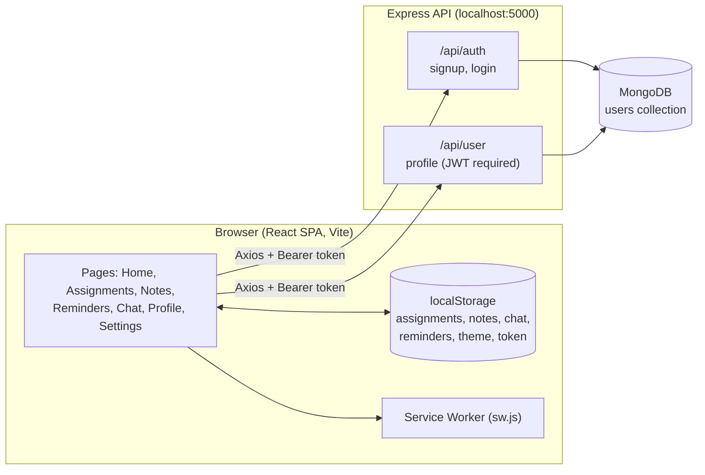

<div align="center">

# 🎓 Student Essential Hub

**A React dashboard that brings a student's assignments, study notes, reminders and chat into one place.**


[Overview](#-overview) · [Features](#-key-features) · [Tech Stack](#-technology-stack) · [Setup](#-installation-and-setup) · [API](#-api-integration) · [Limitations](#-current-limitations) · [Roadmap](#-future-enhancements)

</div>

---

## 📖 Overview

Student Essential Hub is a single-page web application built with React and Vite. After logging in, a student lands on a dashboard with six tools: **Assignments, Chat, Notes, Profile, Reminders and Settings**.

The project has two parts:

- **Frontend** (`src/`): a React SPA with client-side routing and Tailwind CSS styling.
- **Backend** (`server/`): a small Express + MongoDB REST API that handles signup, login and the user profile.

Most productivity tools (Assignments, Notes, Chat, Reminders) currently store their data in the **browser's `localStorage`**, so they work without the backend. Only authentication and the profile page need the API.

> **Project status:** this is a learning / portfolio project that is still in development. See [Current Limitations](#-current-limitations) for an honest list of what is and isn't finished.

## 🎯 Problem Statement

Students usually keep deadlines, notes and reminders in separate apps (a notes app, a phone alarm, a chat app, a to-do list). Switching between them makes it easy to lose track of work.

## ✅ Project Objectives

- Provide one dashboard for the everyday tools a student needs.
- Practise building a secured React application with protected routes and JWT authentication.
- Practise connecting a React frontend to an Express + MongoDB API.
- Use browser features (localStorage, Notifications API, Service Workers, Audio) to build offline-friendly tools.

## ✨ Key Features

Status legend: ✅ working as implemented · 🟡 partially working · 🚧 UI only

| Feature | What it does | Storage | Status |
| --- | --- | --- | :---: |
| **Signup & Login** | Registers a user (password hashed with bcrypt) and logs in with a JWT valid for 7 days | MongoDB + `localStorage` token | ✅ needs backend |
| **Protected routes** | Redirects to the login page when no token is present | `localStorage` | 🟡 checks token presence only, not validity |
| **Dashboard** | Welcome message and quick links to every tool | API (`/api/user/profile`) | ✅ needs backend |
| **Assignments** | Add and delete assignment tasks | `localStorage` | ✅ |
| **Notes** | Upload PDFs, images and other files; open or delete them | `localStorage` (Base64) | 🟡 limited by browser storage size |
| **Reminders** | Choose a date and time on a calendar; a notification and looping alarm sound fire when the time passes; alarm can be stopped; reminders can be toggled or deleted | `localStorage` | 🟡 works only while the tab is open (see limitations) |
| **Chat** | Type messages and keep a history | `localStorage` | 🚧 personal message log only, not multi-user chat |
| **Profile** | Shows the logged-in user's name, email and picture; logout | API | 🟡 **Edit Profile** button has no function yet |
| **Dark mode** | Toggle from the navbar or Settings; preference is remembered | `localStorage` | 🟡 only some pages have dark-mode styles |

## 🧰 Technology Stack

| Layer | Technologies |
| --- | --- |
| **Frontend** | React 19, React Router DOM 7, Vite 6 |
| **Styling** | Tailwind CSS 3, PostCSS, Autoprefixer |
| **UI libraries in use** | react-icons, @heroicons/react, react-calendar, react-datepicker |
| **HTTP client** | Axios |
| **Backend** | Node.js, Express 4, Mongoose 8 (MongoDB) |
| **Security** | bcryptjs (password hashing), jsonwebtoken (JWT), cors |
| **Configuration** | dotenv |
| **Tooling** | ESLint 9 (with react-hooks and react-refresh plugins) |
| **Browser APIs** | localStorage, Notifications API, Service Worker, HTML Audio, FileReader |

**Installed but not yet used in the code:** `firebase`, `framer-motion`, `lucide-react`, `react-tsparticles`. They are listed in `package.json` and can be removed or put to use (see [Future Enhancements](#-future-enhancements)).

## 🏗️ System Architecture



**Authentication flow:** the user logs in, the API returns a JWT, the frontend stores it in `localStorage`, and sends it as `Authorization: Bearer <token>` when requesting the profile. `ProtectedRoute` only checks that a token exists; the API is what verifies it.

## 📁 Project Folder Structure

```
Student-Essential-Hub/
├── public/
│   ├── alarm.mp3                 # Reminder alarm sound
│   ├── sw.js                     # Service worker
│   └── vite.svg
├── server/                       # Express + MongoDB API
│   ├── index.js                  # App entry, DB connection
│   ├── middleware/auth.js        # JWT verification
│   ├── models/User.js            # User schema
│   └── routes/
│       ├── auth.js               # POST /signup, POST /login
│       └── user.js               # GET /profile
├── src/
│   ├── components/
│   │   ├── DarkModeToggle.jsx    # In use (navbar, Settings)
│   │   ├── Header.jsx            # Not used in any route yet
│   │   └── Sidebar.jsx           # Not used in any route yet
│   ├── pages/
│   │   ├── About.jsx             # Not routed yet
│   │   ├── Assignments.jsx
│   │   ├── Chat.jsx
│   │   ├── Home.jsx
│   │   ├── Login.jsx
│   │   ├── Notes.jsx
│   │   ├── Profile.jsx
│   │   ├── Reminders.jsx
│   │   ├── Settings.jsx
│   │   └── Signup.jsx
│   ├── services/
│   │   ├── authService.jsx       # register / login / logout
│   │   └── ProtectedRoute.jsx    # Route guard
│   ├── App.jsx                   # Routes and navbar
│   ├── main.jsx
│   └── index.css                 # Tailwind directives + dashboard card style
├── docs/screenshots/             # Put README screenshots here
├── .env.example
├── eslint.config.js
├── index.html
├── package.json
├── postcss.config.js
├── tailwind.config.js
└── vite.config.js
```

## ⚙️ Installation and Setup

### Prerequisites

| Requirement | Version / notes |
| --- | --- |
| [Node.js](https://nodejs.org/) | 18.18 or later (required by ESLint 9; `npm run server:dev` uses `node --watch`) |
| npm | Comes with Node.js |
| [MongoDB](https://www.mongodb.com/) | A local instance, or a free [MongoDB Atlas](https://www.mongodb.com/atlas) connection string |
| [Git](https://git-scm.com/) | To clone the repository |

### Steps

```bash
# 1. Clone the repository
git clone https://github.com/<your-username>/Student-Essential-Hub.git
cd Student-Essential-Hub

# 2. Install dependencies (frontend and backend share one package.json)
npm install

# 3. Create your environment file
cp .env.example .env        # Windows (PowerShell): copy .env.example .env
```

Then open `.env` and set `MONGO_URI` and a long, random `JWT_SECRET`.

## ▶️ How to Run the Project

Run the backend and frontend in **two separate terminals**:

```bash
# Terminal 1: API on http://localhost:5000
npm run server

# Terminal 2: frontend on http://localhost:5173
npm run dev
```

Open **http://localhost:5173**, click **Create an account**, then log in.

### Available scripts

| Command | Description |
| --- | --- |
| `npm run dev` | Start the Vite development server |
| `npm run build` | Create a production build in `dist/` |
| `npm run preview` | Preview the production build locally |
| `npm run lint` | Run ESLint |
| `npm run server` | Start the Express API |
| `npm run server:dev` | Start the API with auto-restart on file changes |

## 🔐 Environment Variables and Configuration

Defined in `.env` (copy from `.env.example`). The `.env` file is git-ignored; never commit it.

| Variable | Required | Default | Description |
| --- | :---: | --- | --- |
| `MONGO_URI` | Yes | none | MongoDB connection string, e.g. `mongodb://127.0.0.1:27017/student-essential-hub` |
| `JWT_SECRET` | Yes | none | Secret used to sign tokens. Use a long random value |
| `PORT` | No | `5000` | API port |
| `CLIENT_URL` | No | `http://localhost:5173` | Frontend origin allowed by CORS |

The server exits with an error message if `MONGO_URI` or `JWT_SECRET` is missing.

> ⚠️ **Important:** the API address `http://localhost:5000` is **hard-coded** in `src/services/authService.jsx`, `src/pages/Home.jsx` and `src/pages/Profile.jsx`. If you change `PORT` or deploy the API, update those files.

## 🔌 API Integration

Base URL: `http://localhost:5000`

| Method | Endpoint | Auth | Request body | Success response |
| --- | --- | :---: | --- | --- |
| `POST` | `/api/auth/signup` | No | `{ name, email, password }` (password 6+ chars) | `201 { message }` |
| `POST` | `/api/auth/login` | No | `{ email, password }` | `200 { token }` |
| `GET` | `/api/user/profile` | Bearer token | none | `200 { _id, name, email, profilePicture, ... }` (password excluded) |
| `GET` | `/api/health` | No | none | `200 { status: "ok" }` |

Error responses use the shape `{ "message": "..." }` with `400`, `401`, `404`, `409` or `500` status codes.

## 🖼️ Application Screenshots

> Screenshots have not been added yet. Add images to `docs/screenshots/` and replace the placeholders below.

| Login | Dashboard |
| :---: | :---: |
|  |  |

| Reminders | Notes |
| :---: | :---: |
|  |  |

## ⚠️ Current Limitations

Listed openly so that contributors and reviewers know the real state of the project.

| Area | Limitation |
| --- | --- |
| **Data persistence** | Assignments, Notes, Chat and Reminders live only in the browser. Clearing site data or switching device loses them |
| **Notes** | Files are stored as Base64 in `localStorage`, which is typically limited to a few MB per site. Large uploads can fail |
| **Reminders** | Checked once per minute and only while the app is open in a tab. Closing the tab means no alarm. The Service Worker's `push` handler is not connected to any push service, and it references `/icon.png`, which does not exist in `public/` |
| **Chat** | There is no real-time or multi-user messaging. It saves your own messages locally |
| **Authentication** | The JWT is kept in `localStorage`. `ProtectedRoute` only checks that a token exists, and the frontend does not handle an expired token cleanly. The API has no rate limiting |
| **Profile** | The **Edit Profile** button does nothing. The fallback picture URL points to an external placeholder service that may not load |
| **Dark mode** | The toggle works, but only some pages define dark-mode styles; the global background gradient does not change |
| **Unused code** | `Header`, `Sidebar` and `About` are not routed. `firebase`, `framer-motion`, `lucide-react` and `react-tsparticles` are installed but unused |
| **Configuration** | The API URL is hard-coded in the frontend (see above) |
| **Testing** | There are no automated tests |
| **Deployment** | No deployment configuration is included |

## 🚀 Future Enhancements

Planned ideas, **not yet implemented**:

- [ ] Store assignments, notes metadata and reminders in MongoDB, linked to each user
- [ ] Move file uploads to cloud storage instead of `localStorage`
- [ ] Add due dates, priority and completion status to assignments
- [ ] Real-time chat between students (for example with Socket.IO)
- [ ] Working Edit Profile with picture upload
- [ ] Move the API URL into a Vite environment variable (`VITE_API_URL`)
- [ ] Complete dark-mode styling across all pages
- [ ] Web Push notifications so reminders work when the app is closed
- [ ] Add input validation, rate limiting and automated tests
- [ ] Remove unused dependencies, or use them for animations and UI polish
- [ ] Deploy the frontend and API

## 🤝 Contributing

Contributions, issues and suggestions are welcome.

1. Fork the repository
2. Create a branch: `git checkout -b feature/your-feature-name`
3. Make your changes and run `npm run lint` and `npm run build`
4. Commit: `git commit -m "Add: short description"`
5. Push: `git push origin feature/your-feature-name`
6. Open a Pull Request describing what changed and why

## 📄 License

`package.json` declares the **ISC** license. See the [ISC license text](https://opensource.org/license/isc-license-txt). Add a `LICENSE` file with your name and the year before publishing.

## 👤 Author and Credits

**Author:** [Your Name](https://github.com/your-github-username)

**Built with open-source software**, each under its own license: [React](https://react.dev/), [Vite](https://vite.dev/), [Tailwind CSS](https://tailwindcss.com/), [React Router](https://reactrouter.com/), [Express](https://expressjs.com/), [Mongoose](https://mongoosejs.com/), [Axios](https://axios-http.com/), [react-icons](https://react-icons.github.io/react-icons/), [Heroicons](https://heroicons.com/), [react-calendar](https://github.com/wojtekmaj/react-calendar), [react-datepicker](https://github.com/Hacker0x01/react-datepicker).

**Project origin and attribution:**
- Project scaffolding comes from the official Vite React template (`react.svg` and `vite.svg` are template assets).
- The Express/MongoDB backend in `server/` and several frontend fixes (Signup page, route fixes, dark-mode wiring) were written with the help of an AI assistant (Claude by Anthropic).
- The alarm sound `public/alarm.mp3` comes from **[add the source and license here]**.

---

<div align="center">

If you find this project useful, consider giving it a ⭐

</div>
